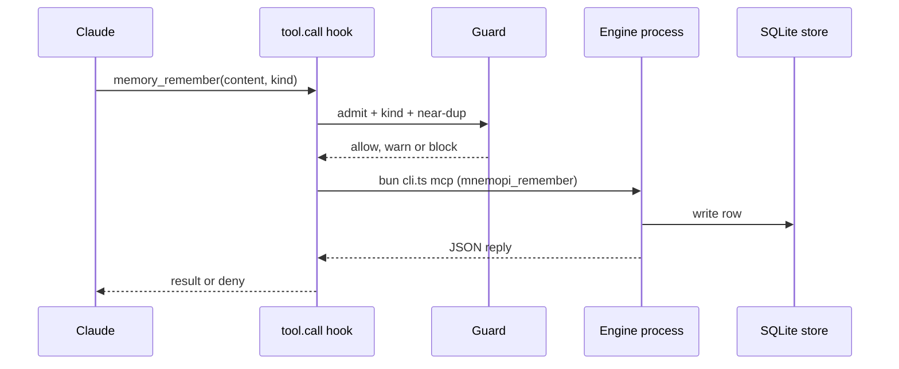

# HAL-M MCP tools: how they work and how to extend them

Scope: the plugin in `/Users/rohits/Development/claude-mnemosyne` (plugin id and tool names are still `mnemosyne`). All findings come from reading the code; nothing was run (no tests, no build). Line numbers are for the checkout at the time of reading (version 0.37.0, engine build from `hooks/engine-build.ts`).

A short vocabulary first:

1. Hook module: `hooks/register.ts`, the one file the Claude Code host loads (`hooks/hooks.json` lists it). It registers the tools and answers every call to them.
2. Engine: the vendored Mnemopi memory database code in `engine/` (SQLite, full-text plus optional embeddings). It speaks the MCP protocol over stdio with its own tool names `mnemopi_*`.
3. Owner: the id a memory belongs to, `global` or `project-...`. It rides on the env var `MNEMOPI_SESSION_ID`.
4. Client mode vs server mode: client mode is a PC plugin with `serverUrl` set (memory lives on the HAL-M server). Server mode is the Docker server (Unraid / Dokploy) that serves `/mcp` and `/api/plugin/*`.

---

## 1. The tools Claude sees

Claude sees exactly six tools, defined in one array `toolsFor(settings)` at `hooks/register.ts:171-271`. The list of names is `TOOL_NAMES` at `hooks/settings.ts:30`. Each can be switched off in `config.json` (setting M1, takes effect next session).

### 1.1 memory_remember (`register.ts:172-204`)

Purpose: save one durable fact.

| Parameter | Type | Required | Notes |
|---|---|---|---|
| content | string | yes | One self-contained fact |
| kind | string enum | yes | One of 8: fact, preference, instruction, decision, context, error, artifact, event (`hooks/kinds.ts:5-14`). 'unknown' cannot be chosen |
| importance | number | no | 0 to 1, default 0.5, clamped (`clamp`, register.ts:293); a non-number silently becomes 0.5 |
| tags | string[] | no | Cleaned by `cleanTags` (`hooks/tags.ts`): kebab-case, max 31 chars each, at most 5 (setting T1), aliases folded, project name dropped. Never required, although the rules text asks for them |
| global | boolean | no | Per-project scope only: true shares with every project |
| expires_in_days | integer | no | 1 to 365; default none, except kind `context` expires after 14 days (setting E1) |
| replaces | string | no | Id of an older memory this one supersedes; it is retired after the save (not deleted) |
| owner | string | no | With replaces only: the owner of the old memory |
| confirm | boolean | no | true overrides a guard warning or a near-duplicate warning; never overrides a block |

Returns: the engine's pretty-printed JSON text, for example `{"status":"stored","memory_id":"<hex id>","bank":"default","content_preview":"...","duplicate":false}` (`engine/src/mcp-tools.ts:675-709`). The plugin then appends plain-text lines: one `HAL-M guard warning: ...` per warning, and a `HAL-M: retired <old>, replaced by <new>...` line when `replaces` was used (`register.ts:2644-2659`). So the reply is not always pure JSON.

Variant when the same text already exists hidden: `status: "retired"` or `"expired"` with a hint that the user can restore it from the dashboard Review tab (`keptReply`, register.ts:1205-1213). Claude cannot restore it itself (see idea 1).

Refusals (all returned as a host "deny" with the text prefixed `HAL-M: `):

1. Guard block: `the save guard blocked this save (G1, G2...). <messages>` (register.ts:2590). Rules in section 3.2.
2. No kind: `no kind given, nothing was saved. Resend memory_remember with kind: one of fact, preference, instruction (rule or runbook), ...` (`kinds.ts:40`).
3. Unknown kind: `unknown kind "x": use one of ...` (`kinds.ts:32-37`).
4. Bad expiry: `expires_in_days must be a whole number from 1 to 365.`
5. Bad replaces/owner: `replaces must be the id of a memory (from memory_recall).` (id pattern `^[A-Za-z0-9_-]{1,64}$`, register.ts:822-831).
6. Needs confirm (strict guard mode, the default): `the save guard warns about this save (G4). ... Resend with confirm: true if the save is wanted.`
7. Near-duplicate (G3, cosine at least 0.88, needs embeddings): `the save guard warns about this save (G3). G3 near-duplicate: close memories already exist: <id> (owner ..., score 0.93): "<preview>". Update one of these instead...` (`guard.ts:192-195`).
8. Engine not installed: `HAL-M Memory engine not installed: ask the user to run /mnemosyne-setup.`
9. Engine too old: `HAL-M Memory engine is out of date (memory_remember and memory_update need build ...)` (register.ts:115-117).

### 1.2 memory_recall (`register.ts:205-217`)

Purpose: keyword plus meaning search over memories (hybrid: full-text, optional embeddings, importance).

| Parameter | Type | Required | Notes |
|---|---|---|---|
| query | string | yes | Natural language |
| limit | integer | no | 1 to 50 (setting R2 max), default 5 (setting R2 default); clamped, never refused |

The description gets an extra sentence about cut rows only when `memory_get` is on (`RECALL_DESCRIPTION_CUT`, `hooks/surface.ts:92`).

Returns: a JSON array (not the engine's object) built by `compact()` (register.ts:861-873): each row has `id`, `owner` (the engine's `session_id`), `content`, `scope`, `timestamp`, and when the 500-character preview cut the text also `truncated: true`, `full_length`, and `note` ("Cut to a preview. Call memory_get with memory_id X and owner Y for the full text."). Everything else the engine returns (importance, memory_type, metadata/tags, recall_count, valid_until, scores) and the engine's `entity` card for "who is X" questions are dropped. The ranking weights from settings (R5: 0.5 vector, 0.3 keyword, 0.2 importance) are sent on every call.

Errors: none from the plugin besides the install/engine ones; an empty query comes back from the engine as plain JSON `{"error":"query is required"}` (engine handlers return `{error}` as a normal result, `mcp-tools.ts:670-673`).

### 1.3 memory_update (`register.ts:218-240`, args built by `updateArgs` register.ts:705-730)

Purpose: change a memory in place; keeps id and recall history.

| Parameter | Type | Required | Notes |
|---|---|---|---|
| memory_id | string | yes | From memory_recall (`id`). Not format-checked here, the engine answers not_found |
| content | string | no | New text; goes through the same guard as a save |
| importance | number | no | 0 to 1, clamped |
| tags | string[] | no | Replaces old tags; `[]` removes them; a list that cleans to nothing is refused |
| kind | string enum | no | Same 8 kinds; sent to the engine as `memory_type` |
| pinned | boolean | no | true pins (never expires or retires); false unpins. Rides the engine's metadata merge |
| confirm | boolean | no | As on remember |
| owner | string | no | The row's owner from recall; default this session's owner |

At least one of content, importance, tags, kind, pinned is needed: `memory_update needs content, importance, tags, kind or pinned.` Other refusals: `tags must be an array of strings.`, `pinned must be true or false.`, unknown kind, `none of those tags can be stored (...). Send tags: [] to remove the tags.`

Returns: engine JSON `{"status":"updated","memory_id":"...","bank":"default"}` or `{"status":"not_found",...}` (not_found is a normal result, and in this path there is no "whose memory is it" hint; only the external proxy adds that, mcp-proxy.ts:459-470). A content change is audited with validator `claude-code` (register.ts:728) and re-runs knowledge extraction in the background (register.ts:2674-2705). A clean content update clears an old `metadata.guard` flag.

Not exposed to Claude although the engine supports them (`engine/src/mcp-tools.ts:284-309`): `restore` (bring back a retired memory) and `valid_until` (set or clear expiry).

### 1.4 memory_forget (`register.ts:241-252`)

Permanently deletes one memory. Parameters: `memory_id` (required string), `owner` (optional). Returns `{"status":"deleted"|"not_found","memory_id":"...","bank":"default"}`. No confirm step, no soft delete. (The soft path is `replaces` on remember, which calls the engine's `mnemopi_invalidate`.)

### 1.5 memory_stats (`register.ts:253-257`)

Input schema is just `{ type: 'object' }` (no properties). Returns `{"status":"ok","provider":"mnemosyne","working":{...},"episodic":{...},"memoria":{...}}` after `mnemosyneStats` (`surface.ts:6-14`) drops the engine's duplicate `stats` block and renames the provider. Counts only; no breakdown by kind, owner, tag, pinned or expiring.

### 1.6 memory_get (`register.ts:258-270`, added in 0.34.0)

Reads one memory in full. Parameters: `memory_id` (required, must match `^[A-Za-z0-9_][A-Za-z0-9_-]{0,63}$`, `surface.ts:26`), `owner` (optional). Returns (`mnemosyneGet`, surface.ts:43-79): `{status:"ok", id, owner, kind, scope, content, length, tags, pinned, importance, source, created_at, timestamp, valid_until, superseded_by}`. Visibility rule (`visibleTo`, surface.ts:34): the row's own owner always (even if retired), a live global row by anyone; anything else answers `{"status":"not_found","memory_id":"..."}` with no engine run and no hint about other owners. A bad id is refused: `memory_id must be the id of a memory (from memory_recall).`

### 1.7 About the id naming question

All three id-taking tools (get, update, forget) use `memory_id`. What differs is the vocabulary around them: recall rows and the session-start block call the same thing `id`, and `memory_remember` takes the same value as `replaces`. The owner is `owner` everywhere in Claude's view, but the engine calls it `session_id`. So a model copying a recalled row has to rename `id` to `memory_id` every time. See idea 2.

---

## 2. Where and how the tools are registered

1. Registration happens at `session.start` inside `register()` (`hooks/register.ts:2212`, handler 2270). Line 2300: `for (const tool of toolsFor(settings)) if (enabled.has(tool.name)) await $.tool.register({ ...tool, isDeferred: false })`. `$.tool.register` is a host API of the Claude Code mod runtime (the type file `types/index.d.ts` is a 13-line stub, so the real signature is not in this repo). `isDeferred: false` most likely means the schema is sent with the tool list instead of being found through tool search (inferred from the name, not verified).
2. The registered tools are virtual: there is no MCP server process behind them for Claude Code sessions. The plugin intercepts each call in a `tool.call` hook (`register.ts:2526`, matcher `/^mcp__mnemosyne__memory_/`) and returns either `{ result }` or `{ deny }`. Claude sees them as `mcp__mnemosyne__memory_*`.
3. Descriptions and schemas are built per session from `config.json` (`settingsFor`, register.ts:537): the tag count (T1), context days (E1), recall limits (R2) are quoted in the text. A change to those texts, or to which tools exist, needs a new session (the settings table marks this `next session`). The set registered for a session is remembered in the `registered` map (register.ts:2218) so the rules text and the remember trigger never name a tool that was not registered.
4. The line "Tools registered by the mnemosyne plugin through $.tool.register." in Claude's MCP server instructions is not in this repo (searched hooks, bin, engine, docs); it comes from the host. The plugin cannot change it.
5. The second channel that reaches Claude is the rules block: a `prompt.compose` handler (register.ts:2713-2720) appends a session-scoped section `mnemosyne:rules` (`rulesSection`, register.ts:125-142). It tells Claude to pass `kind` (required) and 1 to N `tags`, never save secrets, recall before answering past-decision questions, and update or use `replaces` instead of saving near-duplicates. It is only added if `memory_remember` is registered and the prompt is not `bare`.
6. The third channel is the per-prompt context in `prompt.submit` (section 4).
7. Other MCP clients (Cursor, Codex, `claude mcp add`) use a different door: a stdio proxy `bin/mcp-proxy.ts`, launched by a wrapper script `~/.claude/mnemosyne/bin/mnemosyne-mcp` (`hooks/launcher.ts`) when the `externalMcp` option is on. It lists the same six tools, built from the engine's own schemas (`publicSchema`, mcp-proxy.ts:397-409). On the server the same proxy runs once per POST to `/mcp` (section 3.3).

---

## 3. The call path end to end

### 3.1 Diagram (Claude Code session, local mode)

### 3.2 Steps in order (`register.ts:2526-2707`)

1. Name mapping: `mcp__mnemosyne__memory_x` becomes `memory_x`; for get, update, forget the call's `owner` becomes the owner the engine runs as (`as`).
2. Settings read fresh from `config.json` on every call (so guard numbers apply at once).
3. Guard `admit()` (`hooks/guard.ts:145-154`) runs on remember and on update-with-content, before anything else:
   1. G1 secret block: AWS key, GitHub token, sk- keys, Slack token, JWT, private key header, Bearer token, URL with credentials, and `password|secret|api_key|token = <12+ chars>`. Cannot be confirmed.
   2. G2 size: empty block; under 15 characters block; over 4000 block; over 1500 warn.
   3. G7 never-save list from settings: block.
   4. G4 task chatter (dated progress words, "today"): warn, skipped for kinds context, event, instruction, preference, decision.
   5. In strict mode (default option `guardMode`) every warn is refused until `confirm: true`; in warn mode the save goes through flagged in `metadata.guard`.
4. Missing kind: refused (before the near-duplicate check, so one retry fixes both).
5. Stale engine: remember and update are refused (`NOT_CURRENT`); recall, forget, stats, get still run.
6. G3 near-duplicate (`nearDuplicates`, register.ts:789-820): a separate engine process runs `mnemopi_similar` (top 3, min score 0.88). Fails open: embeddings off, engine missing or any error gives no matches. The memory named in `replaces` is excluded. In strict mode a match refuses the save unless `confirm: true`.
7. Other argument checks (kind, expires_in_days, replaces/owner, update fields), then install check.
8. For memory_get only: a read-only store lookup (`bin/memories.ts row-info`) decides visibility before any engine run.
9. `engineArgs` (register.ts:2222-2268) maps to the engine tool. Remember sends `source: 'claude-code'`, `trust_tier: 'DERIVED'`, `author_type: 'agent'`, `scope: 'global'` (or `'channel'` per-project), `memory_type` = kind, `valid_until` computed, `metadata.tags`. If the remember came right after a user remember phrase ("remember that...") and from the main thread, the first save of that turn is upgraded to `author_type: human`, veracity `stated`, source `user`, tier `STATED` (the "trigger" atom, register.ts:2562-2577). A refused save never consumes the trigger.
10. `call()` then `runAll()` (register.ts:750-780): one `bun <engine cli> mcp` process per call, with JSON-RPC `tools/call` lines on stdin (`hooks/engine.ts:100-104`), timeout 20 s, env from `engineEnv` (store path, owner id, embeddings on or off, weights, API routes blanked so memory text never leaves the machine). Replies are parsed by `parseReplies`.
11. After a remember: if `replaces` was given, a second engine call `mnemopi_invalidate` retires the old row as its owner (`retireReplaced`, register.ts:842-856); failure only adds a line, the save stays.
12. Reply shaping: recall goes through `compact()`, get through `mnemosyneGet`, stats through `mnemosyneStats`, remember gets warning/retire lines appended.
13. An activity line is written (origin `tool`) to `~/.claude/mnemosyne/activity.jsonl`, secrets redacted, no memory text on refusals (`hooks/activity-log.ts`; `TOOL_ACTIONS`, line 81).
14. A successful remember, or a content update, queues knowledge extraction (Haiku by default) in the background, one at a time per session (register.ts:2674-2705).

Storage: `<store>/mnemopi.db` (SQLite). Table `working_memory` holds the rows (`id, content, session_id (owner), scope, memory_type, metadata_json, importance, valid_until, superseded_by, ...`); the `memoria_*` tables hold extracted knowledge; the dashboard and `bin/memories.ts` read it read-only.

### 3.3 Local mode versus server mode, per tool

| Tool | Local PC plugin | Client mode (serverUrl set) | External MCP client / server `/mcp` |
|---|---|---|---|
| Entry | tool.call hook | same hook, same guard | proxy `bin/mcp-proxy.ts` |
| Engine run | local `bun cli.ts mcp` | POST `/api/plugin/engine` | proxy spawns engine (on the server for `/mcp`) |
| remember | full path above | guard + near-dup on the PC, engine on server | own guard run, tier EXTERNAL_WRITE, no `replaces` |
| recall | bare array | same | engine object with extra params |
| get | row-info local | row-info via `/api/plugin/memories` | proxy's own row-info check |

Client mode details (`register.ts:342-439`, `bin/remote.ts`):

1. `remoteCall` runs `bun bin/remote.ts <op>` because a hook has no fetch; the key goes on that process's stdin only. Ops: `engine`, `memories`, `resolve`, `project`, `hello`.
2. `runAll` sends `{ owner, requests, timeoutMs }` to `POST /api/plugin/engine` (`ui/server.ts:3187-3194`). The server checks the owner pattern `global|project-...`, at most 200 request lines, and only these engine tools: `mnemopi_remember, recall, update, forget, get, stats, similar, invalidate` (`PLUGIN_TOOLS`, `ui/remote.ts:59-68`), 256 KB body, 60 s cap. It runs the engine as that owner and returns `{stdout, stderr, exitCode}`.
3. The guard, kind check, tag cleaning, `replaces` and trigger logic all stay in the PC's hook. The server does not re-run them on `/api/plugin/engine` (it forwards the args as built). The settings read are the PC's own `config.json`, not the server's.
4. Owner resolution in per-project scope goes through `/api/plugin/resolve`; the project's name is registered with `/api/plugin/project`.
5. Unreachable server: exit 75 marks memory offline for 60 s in that plugin instance; calls then fail at once with `HAL-M server unreachable (memory offline)`. Refused key: `HAL-M server refused the key: check serverKey`.
6. Features that stay server-only in client mode: /mnemosyne-tags, -import, -knowledge, -setup engine install, the dashboard, the session summaries and sweep.

`/mcp` on the server (`ui/server.ts:3163-3174`, `ui/remote.ts:428-485`): bearer device key required; owner from header `Mnemosyne-Owner` (default `global`); batch of up to 50 JSON-RPC messages; `initialize` and `ping` answered locally; the rest go through one `bin/mcp-proxy.ts` run with a synthetic initialize naming the device as the client, guard mode forced to `strict`. So the proxy's rules apply: `memory_remember` needs kind (JSON-RPC error -32602, not a deny), saves are stamped `source: mcp:<device>`, `trust_tier: EXTERNAL_WRITE`, a client's own bank, metadata, veracity, trust_tier and memory_type are dropped, tags cleaned, importance clamped, guard errors carry `data: {rules, verdict}`.

---

## 4. Automatic behaviour that is not a tool call

1. Rules block (every session where memory_remember is registered): section 2 item 5.
2. First-prompt recall (`prompt.submit`, register.ts:2753-2844): on a session's first prompt, the text is split into up to 4 sentences (setting R3), each recalled (up to 5 results, one engine process), de-duplicated, and added as context headed `Long-term memories that may be relevant (HAL-M...)` with `[id owner=...]` on each line and a `[cut]` mark if truncated. Skipped if the setting is off. Re-armed after a conversation compaction (`session.compact` hook, register.ts:2723).
3. Session-start block (same handler; `bin/memories.ts first-prompt`, `hooks/session.ts:224-286`): the last session's summary and up to 5 pinned memories, at most 2000 characters, headed `HAL-M: what we were doing last time, and pinned memories:`. Shown ahead of the recall, and the recall skips what the block already showed.
4. Trigger phrases: a prompt that starts with a remember term (defaults `remember:`, `remember that`, `note that`, `save to memory`) injects "The user invoked a HAL-M remember trigger. Call mcp__mnemosyne__memory_remember exactly once, with a kind, ...", and marks the next main-thread save as the human's. A recall term (`recall:`, `what do you remember about`, `check memory`) recalls that topic now and injects `HAL-M recall for "x" found nothing.` when empty. Only prompts typed by a person count (`PERSON_ORIGINS`, register.ts:120).
5. Background jobs after the first reply: summaries of earlier sessions (kind event, 30-day expiry), the unused-memory expiry sweep (default 90 days, kinds context/event/error/artifact only), knowledge extraction after each save, engine auto-update, log pruning.
6. Slash commands registered at session start (register.ts:2271-2294): `/mnemosyne-setup`, `-tags`, `-import`, `-ui`, `-knowledge`, `-embed`. They are commands, not tools.

---

## 5. Tests and gaps

Tests that cover the tools:

1. `tests/register.test.ts` (303 tests, the main hook-level suite with a fake host). Topics by test-name search: tags and vocabulary (57), update (32), recall (31), guard (22), kind (19), replaces/retire (12), trigger (10), near-duplicate (9), confirm (9), memory_get (9), pinned (8), forget (6), stats (2). Examples: `KINDREQ.1.a1` (no kind refused before any engine run), `META.1.a2` (kind forwarded as memory_type, enum declared on both tools), `GET.1` to `GET.3` (get visibility, cut rows), `WIRE.*` (settings change texts and limits), `recall hands the model only id, owner, content, scope and time, limit clamped` (line 762), `forget deletes as the owner it is given` (771), `stats say HAL-M...` (953).
2. `tests/bun/mcp-proxy.spec.ts` (51 tests, against a real installed engine): tool list is exactly six, no bank or metadata; get visibility; kind, tags, importance clamp; guard block/strict/warn/confirm; stale engine; OWNERHINT; activity log lines; client name; settings-driven limits; allow-list.
3. `tests/bun/remote-client.spec.ts` (13): remote.ts transport, engine call as owner with key on stdin only, memory_get via row-info, offline behaviour. `tests/bun/server-mode.spec.ts` (15): includes "only the plugin engine tools pass" and keys for plugin routes and `/mcp`.
4. `tests/guard.test.ts`, `kinds.test.ts`, `tags.test.ts`, `activity-log.test.ts`, `session.test.ts`, `settings.test.ts`: pure-function tests.
5. `engine/test/*.spec.ts`: engine behaviour (`remember-duplicate`, `update-metadata`, `similar`, `audit-trail`, `kind-and-card`, `recall-no-touch`).

Visible gaps (from reading; not run):

1. Nothing compares the tool schemas of the hook path (`toolsFor`) with the proxy path (`publicSchema`). They already differ (section 6, idea 8).
2. memory_stats has 2 hook tests and memory_forget 6; there is no test for forget or update on a global row of another project through the plain hook path with the not_found case (the hint exists only in the proxy).
3. Client mode: the transport is tested, but there is no end-to-end test that runs remember, update, forget and replaces through `/api/plugin/engine` with the real server.
4. No test pins the exact JSON shapes Claude receives per tool (reply shape is the engine's text, so an engine upgrade can change what Claude sees without a failing test).
5. Possible server hardening gap (inferred, untested): `/api/plugin/engine` forwards raw args for the allowed engine tools, and the engine honours an `args.bank` string (`engine/src/mcp-tools.ts:574-576`), whereas the proxy strips `bank`. A device key therefore can write outside the `default` bank and set its own trust tier or scope through that route. Devices are trusted PCs by design, so this may be acceptable; worth a deliberate decision.
6. Engine handlers return `{error: "..."}` as a normal result for missing fields (e.g. empty query, missing memory_id); the hook passes it through as a success. Claude sees the JSON error text but the host sees no tool error.

---

## 6. Improvement and extension ideas, ranked by value versus effort

Ranking: A is best value for least effort.

| Rank | Idea | Effort | Value |
|---|---|---|---|
| 1 | Restore and retire for Claude | Low | High |
| 2 | Accept `id` as an alias, and echo ids consistently | Low | Medium |
| 3 | Richer recall rows | Low | High |
| 4 | Save receipts (echo what was stored) | Low | Medium |
| 5 | Dry-run check before save | Low-Med | Medium |
| 6 | Recall filters (kind, tags, pinned, since) | Medium | High |
| 7 | One shared schema module for hook and proxy | Medium | High (long term) |
| 8 | Batch forms (ids, memories lists) | Medium | Medium |
| 9 | memory_list (browse without a query) | Medium | High |
| 10 | One error and result envelope | Medium | Medium |
| 11 | Expiry and pin on every write | Low | Medium |
| 12 | Link and timeline tools from the engine | High | Uncertain |

### Idea 1. Restore and retire for Claude (low effort, high value)

Problem: `replaces` retires memories and the reply says they "can be restored", but Claude has no way to do it; the hint says the user must use the dashboard (`register.ts:1205-1209`). Claude can only forget (permanent) or replace.
Change: add `restore: true` to memory_update (the engine already has it, `mcp-tools.ts:301-305`, mutually exclusive with other fields) and a `retire` action (`mnemopi_invalidate` is already allowed by `PLUGIN_TOOLS`), either as `memory_update { retire: true, replacement_id }` or a new tool.
Files: `hooks/register.ts` (toolsFor update schema, `updateArgs`, `engineArgs`, `keptReply` hint text, `rulesSection`), `bin/mcp-proxy.ts` (it already forwards `restore` from the engine schema; add the guard for it and the audit validator), `hooks/activity-log.ts` (action `restore` already exists), `ui/remote.ts` only if a new engine tool is needed, tests in `tests/register.test.ts` and `tests/bun/mcp-proxy.spec.ts`.

### Idea 2. Accept `id` as an alias, name things the same everywhere (low effort, medium value)

Problem: rows show `id` and `owner`, tools take `memory_id` and `owner`, remember takes `replaces`. A model must translate.
Change: accept `id` as an alias of `memory_id` on get, update and forget (and `replaces_id` as an alias of `replaces`); keep `memory_id` documented. Do not rename: existing prompts and tests use `memory_id`.
Files: `hooks/register.ts` (toolsFor, tool.call input read at 2528, engineArgs), `hooks/surface.ts` (`MEMORY_ID` check), `bin/mcp-proxy.ts` (the proxy reads `given.memory_id` at 239).

### Idea 3. Richer recall rows (low effort, high value)

Problem: `compact()` (register.ts:861-873) keeps only `id, owner, content, scope, timestamp`. Claude cannot see kind, tags, pinned, importance, expiry or whether a row is a near match, so it calls memory_get just to decide whether to update, and it loses the engine's entity card (`mcp-tools.ts:774-775`).
Change: add `kind` (from `memory_type`), `tags`, `importance`, `pinned`, `valid_until`, `score` and, when present, an `entity` object. The engine rows already carry these (`recall.ts:604` column list). Return an object `{count, results, entity?}` or keep the array and add fields (the object form is a breaking change for the first-prompt code that calls `compact`).
Files: `hooks/register.ts` (`compact`, first-prompt formatting at 2827), `hooks/surface.ts`, `hooks/activity-log.ts` (`callOutcome` reads `results`), tests (`register.test.ts:762` pins the current shape).

### Idea 4. Save receipts (low effort, medium value)

Problem: the remember reply is the engine's raw text: it does not say which tags were kept (after cleaning and alias folding), which kind, scope or expiry, so Claude cannot tell that three of its tags were dropped.
Change: append a compact line or object: `{status, memory_id, kind, tags:[stored], scope, valid_until, duplicate, guard:[...]}`.
Files: `hooks/register.ts` (around 2644-2659), `bin/mcp-proxy.ts` (same for external clients), tests.

### Idea 5. Dry-run check before save (low to medium effort, medium value)

Problem: a near-duplicate or chatter refusal costs a whole failed call and a retry with `confirm: true`.
Change: `dry_run: true` on memory_remember (or a `memory_check` tool) that runs the guard and `mnemopi_similar` and returns verdict, rule ids, close matches and the cleaned tags, writing nothing. The pieces exist (`admit`, `nearDuplicates`).
Files: `hooks/register.ts` (tool.call branch before `call()`; the activity action would be new), `hooks/settings.ts` (a tool toggle if it is a new tool, `TOOL_NAMES`, `ToolName`), `bin/mcp-proxy.ts` (`ALLOWED`), `hooks/activity-log.ts` (`TOOL_ACTIONS`), `ui/remote.ts` (already allows `mnemopi_similar`).

### Idea 6. Recall filters (medium effort, high value)

Problem: recall is query-only. The engine's core recall already filters by `memoryType`, `veracity`, `source`, `topic` (`engine/src/core/beam/recall.ts:31-53`, 588-590) but the MCP schema (`RECALL_SCHEMA`, `mcp-tools.ts:69-108`) and `handleRecall` do not pass them through. Tag filtering has no engine path (the dashboard does it in SQL, `ui/server.ts:710`).
Change: add `kind`, `pinned`, `since`/`until` (the engine has `queryTime` and temporal weights), and maybe `tags` to memory_recall.
Files: `engine/src/mcp-tools.ts` (schema and handler; record it in `engine/UPSTREAM.md` as a local patch and bump `ENGINE_BUILD` in `hooks/engine-build.ts` so installs update), `hooks/register.ts` (toolsFor, engineArgs), `bin/mcp-proxy.ts`, engine and hook tests.

### Idea 7. One shared schema module (medium effort, high long-term value)

Problem: the six tools are defined twice and have drifted:

1. Claude's recall takes only `query`/`limit`; the proxy shows the engine's recall schema (top_k, temporal_weight, query_time, author_id, channel_id, update_recall_counts, ...).
2. The proxy's recall result is the engine object, the hook's is a bare array.
3. `memory_update` has `pinned` only in the hook path; the proxy has `restore` (from the engine) but not `pinned`.
4. `memory_remember` has `replaces`, `owner`, `global` only in the hook path.

Change: one import-free module (like `hooks/kinds.ts` and `hooks/guard.ts`, which both paths already share) that exports the six definitions, their validators and reply shapers; `toolsFor` and `publicSchema` consume it.
Files: new `hooks/tools.ts`, `hooks/register.ts`, `bin/mcp-proxy.ts`, a parity test in `tests/`.

### Idea 8. Batch forms (medium effort, medium value)

Problem: saving or cleaning ten facts is ten tool calls and ten engine processes (about one bun start each).
Change: `memory_remember { memories: [...] }`, `memory_forget { ids: [...] }`, `memory_get { ids: [...] }`. `runAll` (register.ts:750) already runs many requests in one process (used by first-prompt recall and the importers), and `/api/plugin/engine` accepts 200 lines.
Files: `hooks/register.ts` (the tool.call handler is one long per-call function that would need a per-item loop with per-item verdicts), `hooks/guard.ts` (none), tests. Keep per-item results so one blocked item does not hide the others.

### Idea 9. memory_list: browse without a query (medium effort, high value)

Problem: Claude cannot ask "what pinned memories do I have", "what is about to expire", "show the newest 10 decisions". Recall needs a query and stats gives only counts.
Change: a read-only `memory_list` with `kind`, `tag`, `pinned`, `expiring_in_days`, `sort` (newest, recalled, never), `limit`. The dashboard's `GET /api/memories?sort=&tag=&kind=&limit=` (`ui/server.ts:710`) and `bin/memories.ts` already read this from SQLite. In client mode it must be added to `PLUGIN_MEMORIES_COMMANDS` (`ui/remote.ts:69`), which today allows only `first-prompt` and `row-info`.
Files: `bin/memories.ts` (new command), `hooks/register.ts`, `hooks/settings.ts` (`TOOL_NAMES`), `ui/remote.ts`, `bin/mcp-proxy.ts`, `hooks/activity-log.ts`.

### Idea 10. One error and result envelope (medium effort, medium value)

Problem: a failure reaches Claude through four different channels: a host deny (`HAL-M: ...`), a JSON-RPC error on the proxy (-32602, -32000, -32601), a normal result `{"status":"not_found"}`, and a normal result `{"error":"..."}`. Also the proxy adds an `owner` + `hint` on not_found, the hook path does not.
Change: decide one shape, for example `{ok, status, code, message, hint}` for refusals, and give not_found the owner hint on both paths.
Files: `hooks/register.ts`, `bin/mcp-proxy.ts`, `hooks/surface.ts`, `hooks/activity-log.ts` (`callOutcome`), and many assertions in `register.test.ts` and `mcp-proxy.spec.ts` (this is the riskiest change for the tests).

### Idea 11. Expiry and pin on every write (low effort, medium value)

Problem: `pinned` is only on update, expiry only on remember. Saving a pinned fact takes two calls, and an expiry cannot be changed or cleared later (the engine supports `valid_until` set or null on update).
Change: `pinned` on memory_remember; `expires_in_days` (and `null` to clear) on memory_update.
Files: `hooks/register.ts` (toolsFor, engineArgs, `updateArgs`), `hooks/kinds.ts` (`validUntilFor` reuse), `bin/mcp-proxy.ts` (it drops `valid_until` from clients today), tests.

### Idea 12. Link and timeline tools from the engine (high effort, uncertain value)

The engine already has `mnemopi_triple_add`, `triple_query`, `graph_link`, `graph_query`, `scratchpad_*`, `sleep`, `validate`, `export`, `import`, `diagnose`, `shared_*` (`mcp-tools.ts:378-511`) that the plugin never exposes. Proxy comments say several leak across owners or lose data (`mcp-proxy.ts:1-10`, DESIGN §5.6), so only the triple and graph tools look like candidates, and each needs owner and trust handling, a settings toggle, allow-list entries (`PLUGIN_TOOLS`, `ALLOWED`) and a decision about what the dashboard shows. Worth doing only if "related memories" or temporal facts become a product goal.

### Smaller notes

1. The rules text asks for tags but nothing enforces them. If tags matter, make a missing tag list a soft warning in the reply (like the G4 style) rather than a refusal.
2. `importance` that is not a number silently becomes 0.5 on remember; an explicit refusal would match how `kind` and `expires_in_days` behave.
3. `memory_update` does not validate the `memory_id` format (get does); a malformed id goes to the engine and comes back not_found.
4. Stats could report pinned count, expiring-soon count, per-kind counts and untagged count cheaply, since `bin/memories.ts` already computes similar numbers for the Health tab.

---

## 7. Key files

1. `/Users/rohits/Development/claude-mnemosyne/hooks/register.ts` (tool definitions 171-271, tool.call 2526-2707, prompt hooks 2713-2844, client mode 342-439)
2. `/Users/rohits/Development/claude-mnemosyne/hooks/guard.ts`, `kinds.ts`, `tags.ts`, `surface.ts`, `engine.ts`, `settings.ts`, `session.ts`, `activity-log.ts`
3. `/Users/rohits/Development/claude-mnemosyne/bin/mcp-proxy.ts` (external MCP clients and server `/mcp`)
4. `/Users/rohits/Development/claude-mnemosyne/ui/remote.ts` and `ui/server.ts` (3156-3203) for `/mcp` and `/api/plugin/*`; `bin/remote.ts` for the PC side
5. `/Users/rohits/Development/claude-mnemosyne/engine/src/mcp-tools.ts` and `engine/src/mcp-server.ts` (the engine's own tools)
6. Tests: `tests/register.test.ts`, `tests/bun/mcp-proxy.spec.ts`, `tests/bun/remote-client.spec.ts`, `tests/bun/server-mode.spec.ts`
